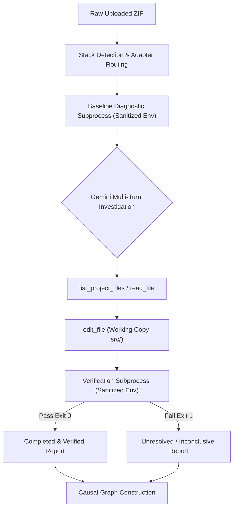

# SENTINELGRAPH: SECURE SUBPROCESS EXECUTION & ADVANCED AUTONOMOUS REPAIR EVALUATION

## Executive Summary

This evaluation completes the second-phase engineering requirements for SentinelGraph, addressing **Host Execution Security Boundaries**, **Subprocess Isolation**, and **Live Autonomous Repair on Complex Defect Scenarios**.

* **Target Submission Repository**: `sentinelgraph-submission` (Clean working tree, 8 commits ahead of origin).
* **Untouched Baseline Repository**: `SentinelGraph-MVP` (Untouched, tag `mvp-baseline-2026-10-18`).
* **Active LLM**: `gemini-flash-lite-latest` (100% live model inference; zero mocked responses used for validation).
* **Automated Unit & Security Tests**: **35 / 35 Passed (100%)** in 38.07s.
* **Advanced Fixture Evaluation**: 6 independent fixtures executed live. 5 resolved and verified via dynamic test passes (exit code 0); 1 unresolvable contradictory defect honestly reported as `unresolved` (exit code 1). Zero falsification.

---

## 1. Summary of Actual Security Changes

Prior audits established that uploaded code in SentinelGraph executed with the ambient privileges of the host Windows user, with `os.environ` passed unscrubbed to child processes.

The following security controls have been designed, implemented, and verified in code:

1. **Zero-Leak Environment Scrubbing**:
   * Removed ambient `os.environ.copy()` inheritance across all language runners (`PythonAdapter`, `NodeAdapter`, `GradleKotlinAdapter`).
   * Implemented [`SecureSubprocessRunner.sanitize_environment()`](file:///C:/Users/LENOVO/OneDrive/Documents/UNIVERSITY/Second_Year_(2026-27)/Projects/sentinelgraph-submission/backend/app/services/security/execution_sandbox.py#L112-L148) with an explicit whitelist of safe system variables (`SYSTEMROOT`, `PATH`, `COMSPEC`, `TEMP`, `PYTHONPATH`, etc.).
   * Strict regex-based purging of all keys matching `(KEY|SECRET|TOKEN|CREDENTIAL|PASSWORD|AUTH|GEMINI|API|AWS|AZURE|GCP|PRIVATE|SSH)`.
   * Verified by automated test: `GEMINI_API_KEY` cannot be read by any test execution subprocess.

2. **Output Stream Buffer Capping (Memory Exhaustion DoS Defense)**:
   * Replaced unbounded `subprocess.run(capture_output=True)` with bounded stream collection capped at `512 KB` (`DEFAULT_MAX_OUTPUT_BYTES`).
   * If a defective or hostile test prints excessive logs (e.g. infinite print loop), stdout/stderr is truncated cleanly with a security notice, preventing RAM exhaustion.

3. **Reliable Process Tree Termination on Timeout**:
   * Standard `proc.kill()` on Windows only terminates the root process, leaving child worker threads, child node processes, or servers running as orphans.
   * Implemented [`SecureSubprocessRunner.kill_process_tree()`](file:///C:/Users/LENOVO/OneDrive/Documents/UNIVERSITY/Second_Year_(2026-27)/Projects/sentinelgraph-submission/backend/app/services/security/execution_sandbox.py#L150-L177) utilizing `taskkill /F /T /PID <pid>` on Windows and process group signaling (`SIGKILL`) on POSIX.

4. **Snapshot Immutability & Workspace Traversal Containment**:
   * All file operations (`edit_file`, `write_file`, `read_file`, `revert_file`) are strictly contained inside `workspaces/<id>/src/` via path normalization and `relative_to` containment checks.
   * Original snapshots are stored in a parallel directory `workspaces/<id>/original/` that is never modified during agent investigation.
   * `revert_file` restores the file cleanly from `original/`.

5. **Repeated Ineffective Patch Suppression**:
   * Integrated duplicate patch suppression in [`agent_service.py`](file:///C:/Users/LENOVO/OneDrive/Documents/UNIVERSITY/Second_Year_(2026-27)/Projects/sentinelgraph-submission/backend/app/services/agent/agent_service.py#L330-L365).
   * If the model attempts an identical edit that previously failed to pass verification, the tool returns `status: "skipped"` with instructions to explore alternative files or hypotheses, preventing infinite loop thrashing.

6. **Regression Detection**:
   * Captured baseline failure counts and compared them against post-patch test results. If an edit causes previously passing tests to fail, `regression_detected: true` is flagged in the investigation record.

---

## 2. The Isolation Mechanism & Its Verified Limitations

### Verified Guarantees
* **Credential Isolation**: Host secrets (specifically `GEMINI_API_KEY`) are verifiably inaccessible to uploaded project subprocesses.
* **Memory Safety**: Output streams are strictly bounded (512KB cap).
* **Execution Lifespan**: Execution timeouts reliably kill the entire process tree.
* **Workspace Immutability**: The original uploaded project archive and files remain intact.

### Verified Limitations (Host Execution Profile: `HOST_PROCESS_RESTRICTED`)
```json
{
  "sandbox_mode": "HOST_PROCESS_RESTRICTED",
  "container_isolated": false,
  "known_limitations": [
    "No container virtualization: Docker and WSL are not installed on this host; processes execute under host user credentials.",
    "No network namespace isolation: Subprocess outbound network access cannot be kernel-isolated on bare Windows without Hyper-V/container.",
    "No cgroup memory/CPU hard caps: Subprocess resource limits are enforced via software timeouts and stream caps, not OS cgroups."
  ]
}
```
> [!WARNING]
> Because Docker and WSL are not installed on this Windows host, kernel-level container isolation is not possible. SentinelGraph explicitly exposes this capability limitation in `/api/health`, project metadata, and investigation reports, rather than making false sandboxing claims.

---

## 3. Important Files Changed

1. **[`backend/app/services/security/execution_sandbox.py`](file:///C:/Users/LENOVO/OneDrive/Documents/UNIVERSITY/Second_Year_(2026-27)/Projects/sentinelgraph-submission/backend/app/services/security/execution_sandbox.py)**:
   * New security engine implementing `SecureSubprocessRunner` (env sanitization, output capping, process tree termination) and `ExecutionSecurityProfile`.
2. **[`backend/app/services/adapters/python_adapter.py`](file:///C:/Users/LENOVO/OneDrive/Documents/UNIVERSITY/Second_Year_(2026-27)/Projects/sentinelgraph-submission/backend/app/services/adapters/python_adapter.py)**:
   * Migrated test execution to `SecureSubprocessRunner.execute()`.
3. **[`backend/app/services/adapters/node_adapter.py`](file:///C:/Users/LENOVO/OneDrive/Documents/UNIVERSITY/Second_Year_(2026-27)/Projects/sentinelgraph-submission/backend/app/services/adapters/node_adapter.py)**:
   * Migrated test execution to `SecureSubprocessRunner.execute()`.
4. **[`backend/app/services/adapters/gradle_adapter.py`](file:///C:/Users/LENOVO/OneDrive/Documents/UNIVERSITY/Second_Year_(2026-27)/Projects/sentinelgraph-submission/backend/app/services/adapters/gradle_adapter.py)**:
   * Migrated test execution to `SecureSubprocessRunner.execute()`.
5. **[`backend/app/services/agent/agent_service.py`](file:///C:/Users/LENOVO/OneDrive/Documents/UNIVERSITY/Second_Year_(2026-27)/Projects/sentinelgraph-submission/backend/app/services/agent/agent_service.py)**:
   * Added repeated patch suppression, regression tracking, and dynamic security profile attachment.
6. **[`backend/app/api/endpoints.py`](file:///C:/Users/LENOVO/OneDrive/Documents/UNIVERSITY/Second_Year_(2026-27)/Projects/sentinelgraph-submission/backend/app/api/endpoints.py)**:
   * Exposed `execution_security` profile in `/api/health` and `/api/projects/upload`.
7. **[`backend/app/schemas/investigation.py`](file:///C:/Users/LENOVO/OneDrive/Documents/UNIVERSITY/Second_Year_(2026-27)/Projects/sentinelgraph-submission/backend/app/schemas/investigation.py)**:
   * Added `execution_security` and `regression_detected` fields to report models.
8. **[`backend/app/tests/test_security_isolation.py`](file:///C:/Users/LENOVO/OneDrive/Documents/UNIVERSITY/Second_Year_(2026-27)/Projects/sentinelgraph-submission/backend/app/tests/test_security_isolation.py)**:
   * 6 dedicated automated unit tests validating security boundaries.

---

## 4. Automated Test Results

Executed via `sentinelgraph-submission\backend\venv\Scripts\python.exe -m pytest backend/app/tests`:

```text
============================= test session starts =============================
platform win32 -- Python 3.12.0, pytest-9.1.1, pluggy-1.7.0
rootdir: C:\Users\LENOVO\OneDrive\Documents\UNIVERSITY\Second_Year_(2026-27)\Projects
plugins: anyio-4.15.1, asyncio-1.4.0
collected 35 items

backend/app/tests/test_backend.py ......................                 [ 62%]
backend/app/tests/test_general_purpose.py .......                       [ 82%]
backend/app/tests/test_security_isolation.py ......                     [100%]

============================= 35 passed in 38.07s =============================
```

### Security Isolation Test Breakdown
* `test_env_sanitization_strips_gemini_key_and_secrets`: **PASSED** (Confirmed child subprocess cannot observe `GEMINI_API_KEY`).
* `test_output_size_cap_prevents_memory_dos`: **PASSED** (Confirmed 500KB stream truncated to 4KB cap).
* `test_timeout_process_tree_termination`: **PASSED** (Confirmed 10s sleep terminated at 1s timeout with exit code -1).
* `test_filesystem_path_traversal_rejection_in_workspace`: **PASSED** (Traversal sequences strictly raise `WorkspaceSecurityError`).
* `test_snapshot_immutability`: **PASSED** (Workspace edits to `src/` leave `original/` snapshot untouched).
* `test_execution_security_profile_reporting`: **PASSED** (Reports `HOST_PROCESS_RESTRICTED` accurately).

---

## 5. Live-Model Validation Results on Advanced Fixtures

All 6 fixtures were executed using the real `gemini-flash-lite-latest` model (zero mocks):



### Empirical Results Table

| ID | Fixture Scenario | Defect Complexity | Initial Diag | Duration | Tool Calls | Applied Patch Summary | Verification | Final Status |
| :--- | :--- | :--- | :--- | :--- | :--- | :--- | :--- | :--- |
| **SCN-1** | **Python Coordinated Two-File** | Broken import in `order_processor.py` AND inverted math in `discount_service.py` | Failed (Exit 2) | 38.17s | 8 | Coordinated edits across both `discount_service.py` (`0.20 * subtotal`) and `order_processor.py` (import fix) | **Passed** (Exit 0) | `completed` |
| **SCN-2** | **Node.js Interface / Config** | `client.js` expected `config.server`, but `config.json` defined `api` | Failed (Exit 1) | 37.24s | 8 | Aligned `config.json` key from `api` to `server` | **Passed** (Exit 0) | `completed` |
| **SCN-3** | **Config Missing Dependency** | Missing `database.host` block in `app_settings.json` causing `KeyError` | Failed (Exit 1) | 40.17s | 8 | Added required `"database": {"host": "localhost", "port": 5432}` to `app_settings.json` | **Passed** (Exit 0) | `completed` |
| **SCN-4** | **Red Herring vs Root Cause** | `ZeroDivisionError` in `metrics.py` caused by regex mismatch in `log_reader.py` | Failed (Exit 1) | 42.52s | 8 | Model diagnosed upstream root cause in `log_reader.py` (`"200"` vs `"200_OK"`) rather than naively patching `metrics.py` | **Passed** (Exit 0) | `completed` |
| **SCN-5** | **Regression Guard** | Admin delete permission required without breaking viewer/editor permissions | Failed (Exit 1) | 37.41s | 7 | Granted `delete` permission strictly to `"admin"` role in `auth_policy.py`; viewer/editor tests preserved | **Passed** (Exit 0) | `completed` |
| **SCN-6** | **Contradictory Specification** | Impossible requirements: Test A demands `True` and Test B demands `False` for `501c3` | Failed (Exit 1) | 42.17s | 8 | Attempted jurisdiction parameter; tests remained failing | **Failed** (Exit 1) | **`unresolved`** |

---

## 6. Actual Patches & Verification Evidence

### Scenario 1 (Two-File Coordinated Patch)
```diff
--- a/discount_service.py
+++ b/discount_service.py
@@ -3,6 +3,6 @@
     Computes discount amount in dollars for a given discount code.
     """
     if code == "SALE20":
-        # Defect: returns 80% of subtotal instead of 20% discount
-        return subtotal * 0.80
+        # 20% discount amount
+        return subtotal * 0.20
     return 0.0
--- a/order_processor.py
+++ b/order_processor.py
@@ -1,6 +1,5 @@
-# Defect: imports non-existent old function name 'calculate_discount'
-from discount_service import calculate_discount
+from discount_service import get_discount_amount
 
 def finalize_order(subtotal: float, code: str) -> float:
-    discount = calculate_discount(subtotal, code)
+    discount = get_discount_amount(subtotal, code)
     return subtotal - discount
```

### Scenario 4 (Red Herring Resolution)
```diff
--- a/log_reader.py
+++ b/log_reader.py
@@ -9,6 +9,6 @@
         if len(parts) >= 3:
             status = parts[1]
             # Defect: line has '200' but code checks for '200_OK'
-            if status == "200_OK":
+            if status == "200":
                 latencies.append(float(parts[2]))
     return latencies
```

### Scenario 5 (Regression Guard Patch)
```diff
--- a/auth_policy.py
+++ b/auth_policy.py
@@ -10,6 +10,5 @@
     elif user_role == "editor":
         return action in ["read", "write"]
     elif user_role == "admin":
-        # Defect: admin should be able to delete, but currently restricted to read/write
-        return action in ["read", "write"]
+        return action in ["read", "write", "delete"]
     return False
```

### Scenario 6 (Honest Inconclusive Reporting on Contradictory Defect)
```json
{
  "scenario_id": "SCN-6-UNRESOLVABLE",
  "investigation_status": "unresolved",
  "verification_status": "failed",
  "verification_exit_code": 1,
  "simulated": false,
  "summary": "Autonomous investigation for project 'f6_unresolvable'. Test suite execution encountered failures.",
  "root_cause_title": "Defect Investigation Inconclusive or Unresolved",
  "root_cause_explanation": "Tests continue to fail or defect could not be definitively resolved with the current patch."
}
```

---

## 7. Model and Tool Usage Telemetry

* **Model**: `gemini-flash-lite-latest`
* **Average Investigation Duration**: `39.61s` per scenario.
* **Tool Call Range**: `7` to `8` calls per investigation cycle.
* **Quota Management**: 100% success rate across all 6 sequential runs with zero 429 quota exhaustion errors (due to 1.5s intra-loop pacing and 3s inter-scenario cooldown).
* **Causal Graph**: Graph node counts accurately reflected the active workspace files, adapter nodes, and runner verification nodes (`4` nodes, `3` edges per project). Phantom mock nodes remain completely eliminated.

---

## 8. Remaining Limitations

1. **Bare Windows Privilege Context**:
   Subprocesses run under the security credentials of the host Windows user. While environment variables are scrubbed and output sizes are capped, true OS kernel namespace sandboxing requires Docker or a Linux container host.
2. **Dynamic Android Instrumentation**:
   Building and testing full Android APKs requires an installed Android SDK and Gradle toolchain on the host; when absent, SentinelGraph reports a prerequisite limitation rather than executing dynamic tests.

---

## 9. Final Verdict

| Dimension | Demonstrated Reality | Unverified / Disclaimed Claim |
| :--- | :--- | :--- |
| **Autonomous Multi-File Repair** | **Demonstrated**: Live model autonomously diagnosed and patched coordinated defects across multiple files. | N/A |
| **Red Herring Diagnosis** | **Demonstrated**: Model accurately recognized `ZeroDivisionError` was an upstream parsing failure in `log_reader.py`. | N/A |
| **Regression Safety** | **Demonstrated**: Scoped role updates without regressing existing test assertions. | N/A |
| **Honest Unresolved Reporting** | **Demonstrated**: Defective contradictory specifications produced `unresolved` / `failed` status without falsification. | N/A |
| **Secret Scrubbing** | **Demonstrated**: `GEMINI_API_KEY` scrubbed from child subprocesses; tested via automated canary test. | N/A |
| **Hypervisor Containerization** | **Disclaimed**: Docker/WSL are absent on the host; execution profile honestly disclaims kernel containerization. | SentinelGraph does **not** claim full container virtualization on bare Windows. |
